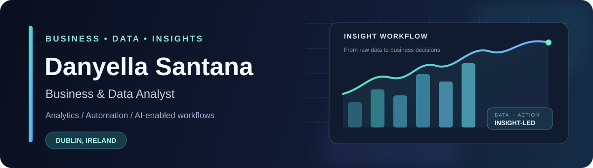

  

  
  
  

<h2 align="center">Turning complex data into clear business decisions.</h2>

  Business &amp; Data Analyst based in Dublin, Ireland 🇮🇪 
  <strong>Business Intelligence · Customer &amp; Commercial Analytics · Automation · Applied AI</strong>

---

## ◈ Analytics snapshot

<table>
  <tr>
    <td align="center" width="33%">
      <h2>240+</h2>
      Post-campaign analyses delivered
    </td>
    <td align="center" width="33%">
      <h2>29+</h2>
      FMCG brands supported
    </td>
    <td align="center" width="33%">
      <h2>800K+</h2>
      Active SuperValu loyalty-card customers in the data scope
    </td>
  </tr>
  <tr>
    <td align="center">
      <h2>8M+</h2>
      Telecom customer database analysed
    </td>
    <td align="center">
      <h2>~60%</h2>
      Less manual effort in image sourcing across 800+ folders
    </td>
    <td align="center">
      <h2>~20%</h2>
      Estimated reduction in campaign analysis time with a custom Copilot agent
    </td>
  </tr>
</table>

Impact figures refer to different projects and work contexts. The ~20% Copilot time saving is an estimate; manual review remained part of the workflow.

## ◈ About

I’m a business and data professional with **8+ years of experience** working across customer, commercial and operational analytics in retail media, telecommunications, inflight entertainment and logistics.

I enjoy connecting business questions with practical analysis: shaping KPIs, exploring large datasets, building reporting, identifying performance drivers and turning findings into recommendations. I also look for opportunities to make analytical work more consistent and efficient through automation and applied AI.

My work combines hands-on analytics with an understanding of the operational context behind the numbers.

## ◈ Experience highlights

<table>
  <tr>
    <td width="25%"><strong>Musgrave Elevate</strong> Data &amp; Insights Lead Nov 2025 – Nov 2026</td>
    <td>Delivered 240+ post-campaign analyses across 18 PA cycles for 29+ FMCG brands. Analysed omnichannel campaign performance and shopper behaviour using first-party loyalty data. Built a custom Microsoft 365 Copilot Agent Builder agent to support analysis of campaign Excel files and Power BI dashboards and assist with insight generation.</td>
  </tr>
  <tr>
    <td><strong>Inflight Dublin</strong> Data Analyst — Metadata &amp; Automation Jul 2022 – Oct 2025</td>
    <td>Built Python and Excel automation for content and metadata workflows. Image-sourcing automation across 800+ folders reduced manual effort by approximately 60%. A translation database and generator reduced translation costs by ~40% and processing time by 50%.</td>
  </tr>
  <tr>
    <td><strong>Oi S.A.</strong> Marketing Data Analyst Sep 2018 – Oct 2021</td>
    <td>Analysed acquisition, retention, churn and customer value across a database of 8M+ customers. Built KPI reporting and dashboards to support commercial and customer operations. Previously worked as a Customer Relationship Intern (Dec 2017 – Sep 2018).</td>
  </tr>
  <tr>
    <td><strong>Kefron &amp; RioCard</strong> Earlier experience</td>
    <td>Built practical experience in document and data processing, data quality, B2B order processing, inventory checks, shipment tracking and logistics coordination.</td>
  </tr>
</table>

## ◈ Selected projects

<table>
  <tr>
    <td width="50%">
      <h3>01 · Market intelligence</h3>
      <strong><a href="https://github.com/DanyCSantana/sql-python-powerbi-sales-insights">Diageo Market Insights</a></strong> 
      SQL · Python · DuckDB · Power BI
      
End-to-end market analysis using 26M+ rows of Iowa liquor sales data, from data preparation and modelling to dashboards and executive recommendations.

    </td>
    <td width="50%">
      <h3>02 · Process automation</h3>
      <strong><a href="https://github.com/DanyCSantana/Image-Sourcing-Automation">Image Sourcing Automation</a></strong> 
      Python · pandas · openpyxl · Regex
      
Automated image sourcing and organisation across 800+ folders, reducing manual effort by approximately 60%.

    </td>
  </tr>
  <tr>
    <td>
      <h3>03 · Media operations</h3>
      <strong><a href="https://github.com/DanyCSantana/image_automation_suite">Image Automation Suite</a></strong> 
      Python · Pillow
      
Batch image resizing, cropping, compression and file organisation for entertainment-media workflows.

    </td>
    <td>
      <h3>04 · Data extraction</h3>
      <strong><a href="https://github.com/DanyCSantana/Automate-Dropbox-downloader">Bulk Dropbox Downloader with OCR</a></strong> 
      Python · OCR · Automation
      
Automates the download, classification and handling of media assets, reducing repetitive manual sorting.

    </td>
  </tr>
  <tr>
    <td>
      <h3>05 · Customer analytics</h3>
      <strong><a href="https://github.com/DanyCSantana/Churn-Project-Coursera">Telecom Churn Analysis</a></strong> 
      Python · pandas · Matplotlib · Seaborn
      
Explores churn drivers and customer-retention opportunities using telecom customer data.

    </td>
    <td>
      <h3>06 · Data quality</h3>
      <strong><a href="https://github.com/DanyCSantana/Content-Metadata-Cleaner">Content Metadata Cleaner</a></strong> 
      Python · pandas · openpyxl
      
Standardises title and version metadata, consolidates language information and produces structured Excel outputs.

    </td>
  </tr>
</table>

## ◈ Toolkit

| Analytics & BI | Data & automation | Business & operations |
|---|---|---|
| Power BI · Tableau · SQL · SAS Enterprise Guide · Databricks | Python · pandas · openpyxl · Pillow · Excel VBA · OCR | KPI reporting · Customer analytics · Churn & retention · Campaign measurement · Process improvement · Supply chain & logistics |

**Applied AI:** Microsoft 365 Copilot Agent Builder · Custom agent instructions · Prompt design · Knowledge sources

## ◈ Education

- **BSc Business Administration** — Federal Rural University of Rio de Janeiro (UFRRJ)
- **Google Advanced Data Analytics Professional Certificate** — 2025
- **Introductory Data Analytics** — UCD Professional Academy

## ◈ Let’s connect

  I’m interested in hands-on opportunities across Business Analysis, Data Analytics, Business Intelligence, Commercial Insights and Operations Analytics.

  <a href="https://www.linkedin.com/in/danyella-santana"><strong>LinkedIn ↗</strong></a> &nbsp;·&nbsp;
  <a href="https://github.com/DanyCSantana/Portfolio"><strong>Portfolio ↗</strong></a> &nbsp;·&nbsp;
  <a href="mailto:danycsantana@live.com"><strong>Email ↗</strong></a>

Portuguese · English · Spanish (Intermediate) &nbsp;|&nbsp; Dublin, Ireland

